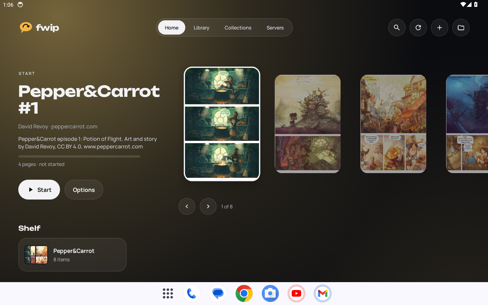
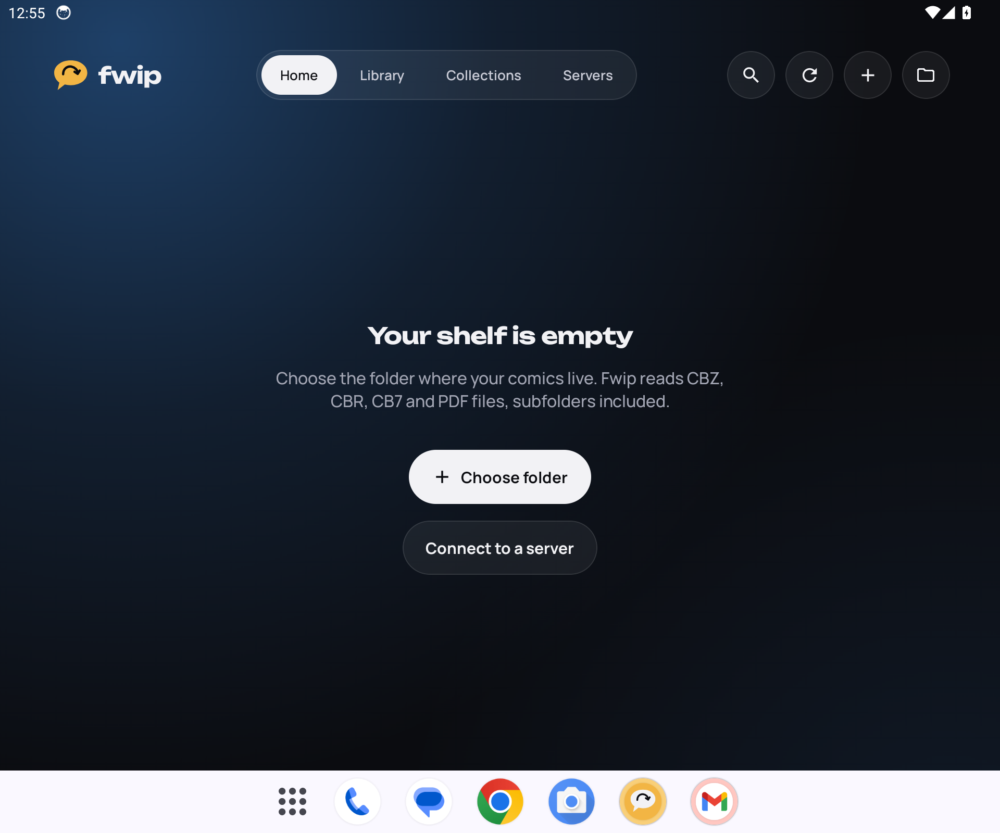
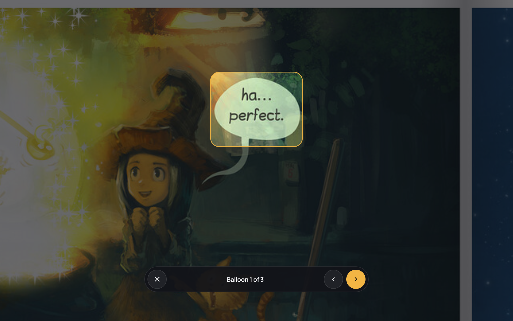
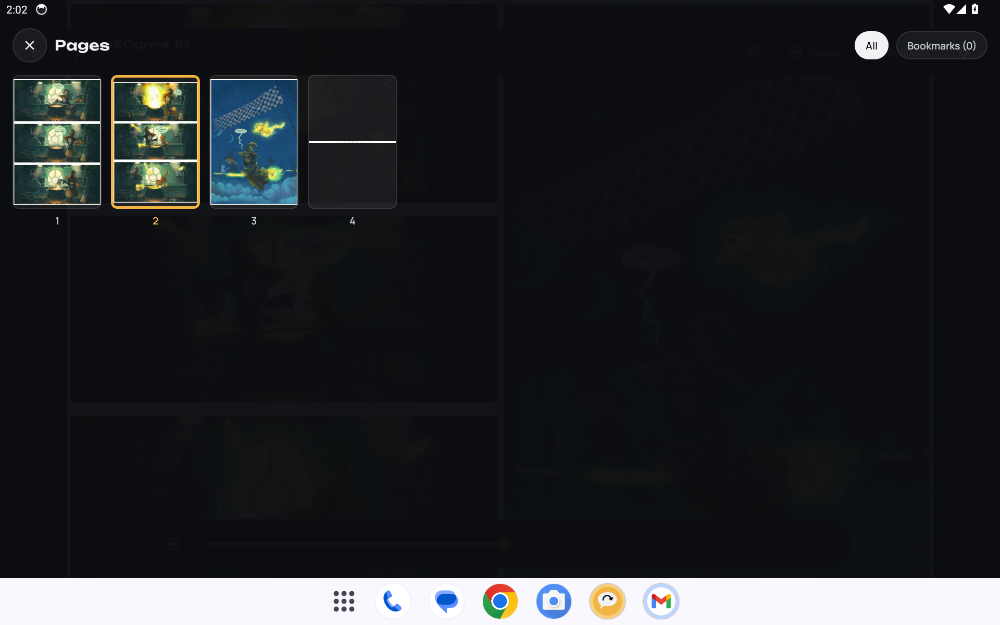
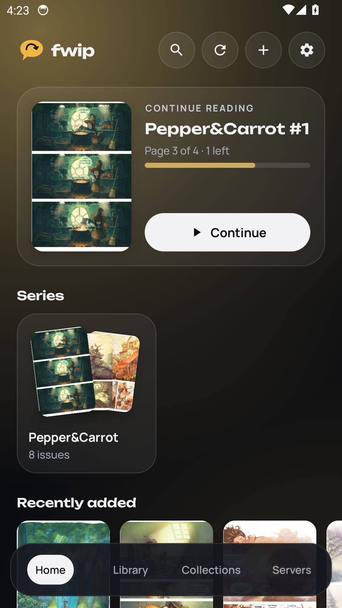
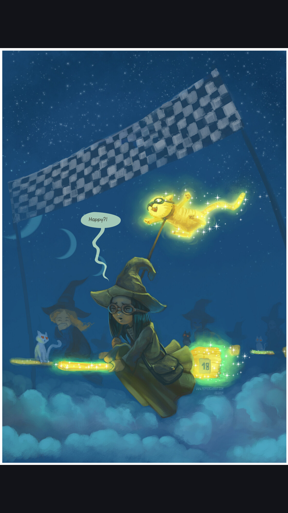

# fwip

A comic reader for Android tablets and phones, inspired by Panels on iOS.
Fluid, simple and made to feel like reading a real comic book.

> Early development. Expect rough edges and frequent changes.

<p>
  
  
</p>
<p>
  
  
</p>
<p>
  
  
</p>

<sub>Sample pages: <a href="https://www.peppercarrot.com">Pepper&amp;Carrot</a> by David Revoy, CC BY 4.0.</sub>

## Features

**Reading**
- Paper page curl that follows your finger, with the back of the sheet and soft shadows; in landscape on tablets the page turns over the spine of a double spread
- Guided reading, panel by panel or balloon by balloon: panels are found from the page gutters (with the ML model as a fallback) and speech balloons by an on-device model, both in reading order with a spotlight; double tap a balloon to zoom straight into it
- Page overview with thumbnails, page previews while you drag the page bar, bookmarks, manga mode (right to left), automatic margin cropping, wide double pages shown whole
- Vertical scrolling for webtoons and long strips (picked automatically for very tall pages)
- Comfort: brightness just for reading, warm night light, keep the screen on, rotation lock, configurable tap zones, volume keys, a light vibration and an optional paper sound on each turn
- Reader look: black, gray or paper background, spine shadow strength and an optional paper texture on the turning page

**Library**
- Your own folders (subfolders included): CBZ, CBR (RAR4 and RAR5, solid archives too), CB7 and PDF
- Launcher-style home: cover carousel with an ambient glow that follows the selected comic, a swipeable shelf of series, collections and folders, and a roomier layout for tablets held upright
- The cover you tap grows into the reader, and shrinks back into its place when you close it
- Pinch to make covers bigger or smaller; a short welcome on first launch
- Make it yours: six themes (Night, Paper, OLED, Comic, Manga, or follow the system) each with its own matching colours and title font; the highlight colour can also follow the selected cover or your wallpaper
- Backdrops (cover glow, solid, slowly moving colours or your own picture), cover corners, shadows, titles and read marks (badge, ribbon or faded), a flat, tilted or fanned carousel
- Home sections you can turn on, reorder and add to (pin a collection or a series), plus an optional greeting with your name
- A choice of app icons that match the themes and colours
- Series (even with a single issue), folders, your own collections with a reading order for events, a "Want to read" list, read/unread, filters, sorting and search
- Fix names, series and covers by hand: edit an issue, rename a whole series, or pick a cover from any page or image
- Delete comics or move them between folders, the app's downloads and your NAS, keeping progress and collections
- Reading statistics: pages, time, finished comics, streaks and completed series
- ComicInfo.xml metadata: series and issue numbers, credits, publisher, date, synopsis; manga flagged as right to left opens in manga mode
- Reset the progress of a comic, next issue card at the end of a comic, a "Continue reading" home screen widget and icon shortcuts

**Your NAS and your devices**
- Network folders over SMB (Windows shares, Samba, most NAS) and WebDAV: comics are read in place, a block at a time, or copied for offline reading
- Komga, Kavita and OPDS servers: browse and search catalogs, read online page by page (progress synced back to Komga) or download
- Sync between your tablet and phone without an account: progress, bookmarks and collections go through a folder both devices share (one kept in step by Syncthing or similar, or a network folder). Each device writes its own small file in a hidden `.fwip` folder there and reads the others', so sync tools never see conflicting edits. Comics are matched by file name and size
- Backup and restore in a single file (servers are saved without passwords)
- A notice on the home screen when a new version is out on GitHub, and a crash report you can save and send
- English and Portuguese (follows the system, or pick the app language on Android 13+)

## Install a test build

1. On your device, open the [latest test build](../../releases/tag/teste) and download `fwip.apk`.
2. Open the file and allow installing from this source when Android asks.
3. Open Fwip, tap **Choose folder** and pick the folder where your comics live, or connect a server in the **Servers** tab.

Every push to `main` builds a new APK automatically, and it installs over the previous one keeping your library and progress.

## Releases

Tagged versions (`v0.3.0` and so on) are built and signed with a private key by the Release workflow; see [RELEASING.md](RELEASING.md). Store texts and images for F-Droid live in `fastlane/metadata/android`.

## Translations

Texts live in `app/src/main/res/values/strings.xml` (English) and `values-pt/strings.xml` (Portuguese). To add a language, copy the English file to `values-<code>/strings.xml`, translate it and add the locale to `res/xml/locales_config.xml`.

## Building

Requires JDK 17 and the Android SDK.

```
./gradlew assembleRelease
```

The APK ends up in `app/build/outputs/apk/release/`.

Test builds are signed with the development key in `keystore/`. It is public on purpose so that anyone's builds can update each other; official store releases will use a private key.

## Tech

Kotlin, Jetpack Compose, Glance, LiteRT (TensorFlow Lite), Apache Commons Compress, junrar, 7-Zip-JBinding, smbj, OkHttp, Android PdfRenderer, Coil.

## License

Fwip is free software, released under the [GNU General Public License v3.0](LICENSE) or later.
You can use, study, share and modify it, as long as derived versions stay under the same license.

## Credits

Screenshots show [Pepper&Carrot](https://www.peppercarrot.com) by David Revoy (CC BY 4.0), built into sample comics by `scripts/sample_comics.py`; the Screenshots workflow takes them on an emulator when a commit message contains `[screenshots]`.

Speech balloon detection uses the YOLOv4-tiny model trained by [Seeneva](https://github.com/Seeneva/seeneva-reader-android) (GPL-3.0-or-later, Copyright 2021-2023 Sergei Solodovnikov), see `app/src/main/assets/balloons/NOTICE.txt`.

Archives in RAR5 format are read with [7-Zip-JBinding-4Android](https://github.com/omicronapps/7-Zip-JBinding-4Android) (LGPL 2.1 with the unRAR restriction). SMB shares use [smbj](https://github.com/hierynomus/smbj) (Apache 2.0).

Fonts: [Unbounded](https://github.com/googlefonts/unbounded) and [Manrope](https://github.com/sharanda/manrope), both under the SIL Open Font License 1.1 (see `FONTS-OFL.txt`).
