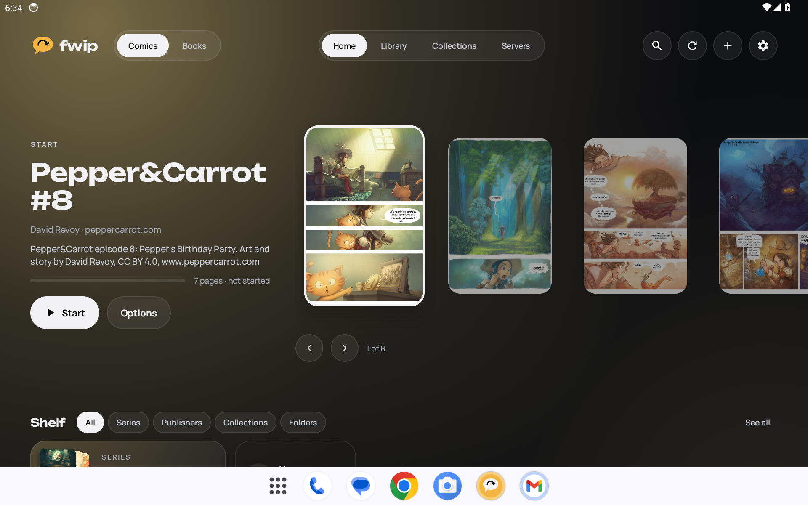
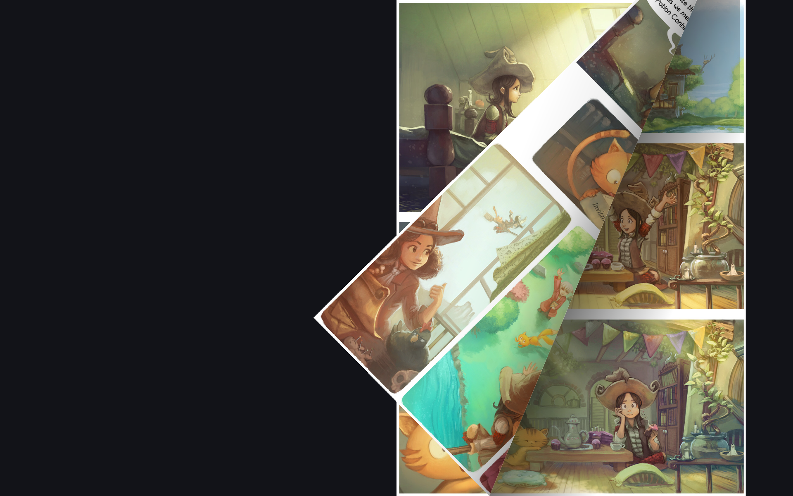
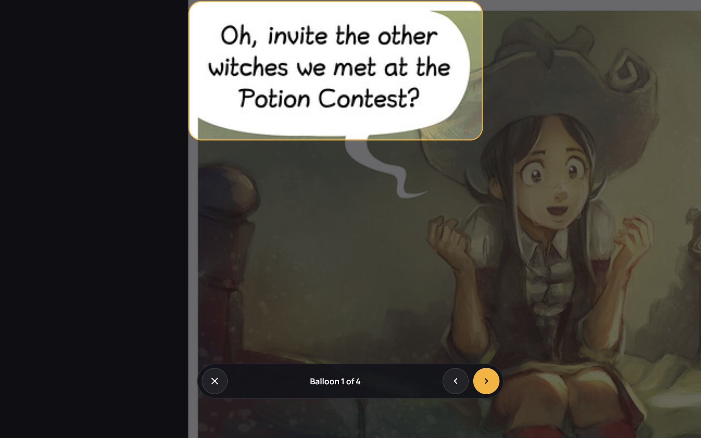
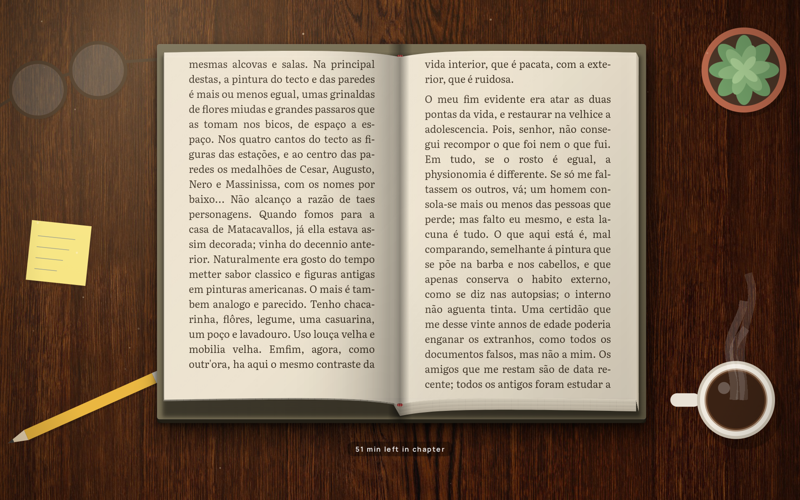
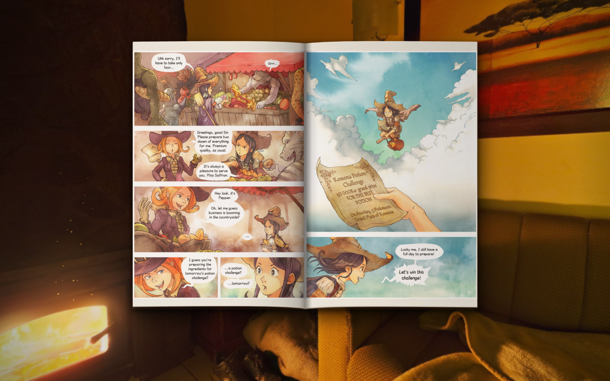
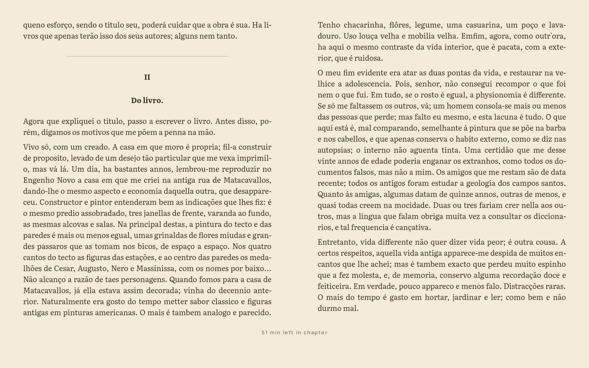
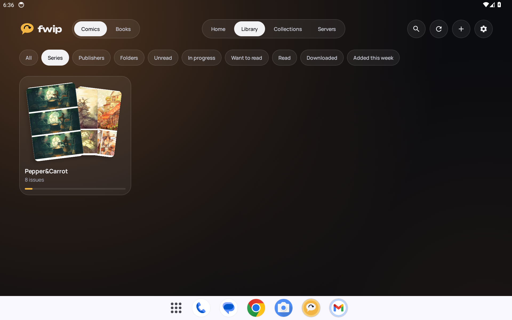
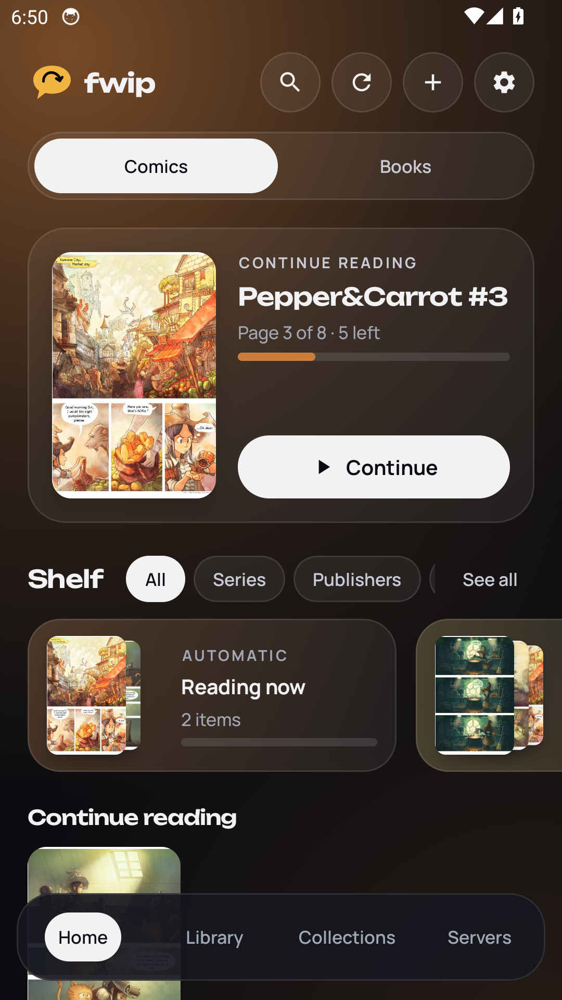
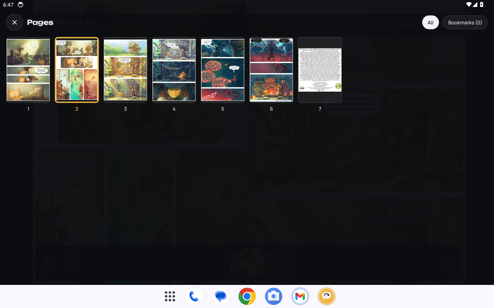

<div align="center">


# Fwip

**HQs e livros no Android, lidos como papel.**<br>
Inspirado no Panels do iOS. Feito para tablets, em casa no celular. Livre e de código aberto.

<a href="https://github.com/ChristianDonatti/fwip/releases/latest"></a>

<a href="LICENSE"></a>

[English](README.md) · [Baixar](https://github.com/ChristianDonatti/fwip/releases/latest) · [Tudo o que faz](#tudo-o-que-faz) · [Compilar](#compilar)

<br>



</div>

<br>

## Por que o Fwip

<table>
<tr>
<td width="33%" valign="top">

### 📖 Papel que vira
A página curva sob o dedo, mostra o verso e faz uma sombra suave. Em 3D o livro fica num lugar, na lareira ou na escrivaninha, e fecha quando você termina.

</td>
<td width="33%" valign="top">

### 💬 Quadro a quadro
A leitura guiada acha os quadros e os balões no próprio aparelho e passa por eles na ordem. Dois toques num balão dão zoom direto nele.

</td>
<td width="33%" valign="top">

### 🗄️ Seus arquivos, seu NAS
Suas pastas, compartilhamentos SMB e WebDAV, Komga, Kavita e OPDS. O progresso acompanha você entre tablet e celular, sem conta.

</td>
</tr>
</table>

## Por dentro

<table>
<tr>
<td width="50%"><p align="center"><sub><b>Uma página que vira como papel</b></sub></p></td>
<td width="50%"><p align="center"><sub><b>Balão por balão</b></sub></p></td>
</tr>
<tr>
<td width="50%"><p align="center"><sub><b>Livro 3D: capa dura, brochura ou grampeada</b></sub></p></td>
<td width="50%"><p align="center"><sub><b>HQs em 3D, com a luz do lugar</b></sub></p></td>
</tr>
<tr>
<td width="50%"><p align="center"><sub><b>Livros: EPUB, Kindle, FB2 e TXT</b></sub></p></td>
<td width="50%"><p align="center"><sub><b>Séries, filtros e progresso num relance</b></sub></p></td>
</tr>
</table>

<p align="center">
  
  
  
</p>

<p align="center"><sub>Páginas de exemplo: <a href="https://www.peppercarrot.com">Pepper&amp;Carrot</a> de David Revoy, CC BY 4.0. Livro: <i>Dom Casmurro</i> de Machado de Assis, domínio público.</sub></p>

## Destaques

- **HQs:** CBZ, CBR (RAR4 e RAR5), CB7 e PDF, páginas duplas no tablet, modo mangá, rolagem de webtoon, corte de margens e filtros para scans antigos
- **Livros:** EPUB e Kindle sem DRM, suas fontes, destaques com notas, dicionário, leitura em voz alta e tempo restante no seu ritmo
- **3D:** oito lugares, desenhados ou em foto, com movimento e som ambiente criado na hora; a luz do lugar cai sobre a página
- **Biblioteca:** um Início que acompanha sua leitura, séries e coleções, filtros rápidos, deslizar para marcar como lida, capas geradas, widgets e estatísticas
- **Conforto:** brilho abaixo do mínimo, luz quente, visual e-ink, travar a rotação, botões de volume e zonas de toque à sua escolha
- **Rede:** leia do NAS direto ou baixe, mande HQs novas para o NAS sozinhas, sincronize o progresso por uma pasta compartilhada
- **Atualização dentro do app**, backup num arquivo só, inglês e português

## Instalar

1. Abra a [versão mais recente](https://github.com/ChristianDonatti/fwip/releases/latest) no aparelho e baixe o APK.
2. Abra o arquivo e permita instalar desta fonte quando o Android pedir.
3. Abra o Fwip, toque em **Escolher pasta** e escolha onde ficam suas HQs e livros, ou conecte um servidor na aba **Servidores**.

Versões novas aparecem no Início; **Atualizar** baixa e instala dentro do app.

<details>
<summary><b>Versões de teste</b></summary>

Cada push na `main` gera um [APK de teste](https://github.com/ChristianDonatti/fwip/releases/tag/teste). Versões de teste usam uma chave pública de desenvolvimento, então instalam por cima umas das outras, mas não por cima de uma versão oficial (faça backup nos Ajustes, desinstale, instale e restaure).

</details>

## Tudo o que faz

<details>
<summary><b>Abrir a lista completa</b></summary>

#### Livros
- EPUB, arquivos Kindle sem DRM (MOBI, AZW3, PRC), FB2 e TXT, diagramados pelo Readium; arquivos Kindle viram EPUB com a libmobi, TXT e FB2 são convertidos uma vez e guardados
- HQs e livros dividem a biblioteca, as coleções e a sincronização; com os dois, uma chave no topo mostra um ou outro, e os livros podem ficar numa estante pelas lombadas
- Texto e página: sete cores de página (papel, e-ink, calma, noite e outras), fontes feitas para leitura (Literata, Bitter, Atkinson Hyperlegible, OpenDyslexic) ou suas próprias TTF e OTF, tamanho, entrelinha, margens, texto justificado, hifenização, texto mais forte, estilos da editora, uma ou duas colunas
- Virada de página como papel (a folha curva sob o dedo, como nas HQs), ou instantânea, deslizando ou rolagem contínua
- Livro 3D (livros e HQs): o livro fica num lugar, o papel subindo a partir da lombada, o bloco de folhas crescendo à esquerda conforme você lê, e a capa que abre quando você começa e fecha quando termina; capa dura, brochura ou HQ grampeada (pelo tamanho, ou à sua escolha), a cor da luz do lugar na página e o tamanho que você quiser
- Lugares, cada um desenhado e em foto, com movimento: escrivaninha, biblioteca, lareira, montanhas, parque, janela com chuva sobre a cidade, praia ao pôr do sol, noite estrelada; som ambiente criado na hora pelo app (fogo, chuva, vento, pássaros, ondas, grilos, relógio) e profundidade ao inclinar o tablet
- Tempo restante no capítulo ou no livro no seu ritmo de leitura, como no Kindle; toque na linha para ver página ou porcentagem
- Sumário, marcadores, busca no livro todo, destaques em quatro cores com notas, compartilhados em Markdown, e dicionário
- Leitura em voz alta com as vozes do aparelho, velocidade e timer para dormir (minutos ou fim do capítulo)

#### Luz de e-reader
- Brilho abaixo do mínimo do sistema, luz quente à mão, no pôr do sol ou num horário, e o sensor de luz do ambiente
- Temas e-ink para o app e visual e-ink para as páginas das HQs (16 cinzas ou cor suave), com piscada de atualização opcional
- Relógio e bateria na página, modo foco (não perturbe durante a leitura) e protetor de tela com suas capas

#### Lendo HQs
- Virada de página de papel que segue o dedo, com o verso da folha e sombras suaves; no tablet deitado a página vira sobre a lombada de uma página dupla
- Leitura guiada, quadro a quadro ou balão por balão: os quadros são achados pelas calhas da página (com o modelo de ML de reserva) e os balões por um modelo no aparelho, os dois na ordem de leitura com um foco de luz; dois toques num balão dão zoom direto nele
- Grade de páginas com miniaturas, barra de páginas feita de paginazinhas (como no Panels) com prévia grande ao arrastar, marcadores, modo mangá (direita para esquerda), corte automático de margens, páginas duplas largas mostradas inteiras
- Rolagem vertical para webtoons e tiras longas (escolhida sozinha para páginas muito altas)
- Seus gestos: escolha o que fazem dois toques, toque longo e deslizar para cima ou para baixo (zoom, controles, grade de páginas, marcador, quadro a quadro, fechar)
- Sensação da virada: quatro sons de página, velocidade, altura do arco e profundidade da sombra da dobra
- Conforto: brilho só para a leitura, luz quente à noite, tela sempre ligada, travar a rotação, zonas de toque configuráveis, botões de volume, vibração leve e som de papel opcional a cada virada
- Visual do leitor: fundo preto, cinza ou papel, força da sombra da lombada e textura de papel opcional na folha que vira
- Filtros para scans antigos: papel amarelado volta a ficar branco e tinta desbotada fica mais escura, menos ruído, traços mais nítidos
- Páginas duplas divididas em duas metades quando só cabe uma página na tela

#### Biblioteca
- Suas próprias pastas (com subpastas): CBZ, CBR (RAR4 e RAR5, inclusive sólidos), CB7 e PDF
- Início no estilo de launcher: carrossel de capas com brilho que segue a HQ escolhida, prateleira de séries, coleções e pastas, e um layout mais espaçoso para o tablet em pé
- A capa que você toca cresce até virar o leitor e volta ao lugar quando você fecha
- O Início acompanha sua leitura: termine uma edição e a próxima da série espera no topo, marcada como A seguir
- Na lista, deslize uma linha para a direita para marcar como lida ou para a esquerda para pôr em Quero ler, com desfazer
- Livros sem capa ganham uma capa gerada (quatro estilos, com título, autor e série)
- Um guia curto de toques e gestos na primeira vez em cada leitor, e um cartão no fim que mostra quanto falta da série
- Filtros rápidos na Biblioteca (Em andamento, Baixadas, Adicionadas esta semana), quanto de cada série você já leu no cartão dela, e travar a rotação nos dois leitores
- Mensagens claras quando um arquivo não abre (danificado, sumiu, sem internet, sem acesso) com Tentar de novo, e um aviso quando uma pasta ou servidor não pôde ser lido
- Pinça para aumentar ou diminuir as capas; boas-vindas curtas na primeira vez
- Do seu jeito: seis temas (Noite, Papel, OLED, Gibi, Mangá ou o do sistema), cada um com suas cores e fonte de título; a cor de destaque também pode seguir a capa escolhida ou o papel de parede
- Fundos (brilho da capa, cor sólida, cores em movimento lento ou uma foto sua), cantos das capas, sombras, títulos e marcas de lido (selo, faixa ou esmaecido), carrossel reto, inclinado ou em leque
- Seções do Início que você liga, reordena e acrescenta (fixe uma coleção ou série), e uma saudação com seu nome se quiser
- Ícones do app que combinam com os temas e cores
- Séries (mesmo com uma edição só), pastas, suas coleções com ordem de leitura para eventos, lista "Quero ler", lidas e não lidas, filtros, ordem e busca
- Listas de leitura do ComicRack (.cbl) importadas como coleções na ordem de leitura, com a lista das edições que faltam
- Selo NOVO nas HQs que acabaram de chegar e, se quiser, notificação quando sai uma edição nova de uma série que você lê (no NAS também)
- Sua cor, imagem e logo para qualquer série, pasta, coleção ou editora; editoras ganham prateleiras próprias
- A biblioteca em capas ou lista compacta; progresso nas capas como barra, anel, porcentagem ou nada; escolha a aba de abertura e esconda as que não usa
- Tela de armazenamento: quanto ocupam downloads, capas e arquivos temporários, e downloads lidos apagados sozinhos quando ainda estão no NAS
- Receba HQs pelo Wi-Fi: abra no navegador do computador o endereço mostrado e solte os arquivos
- Corrija nomes, séries e capas à mão: edite uma edição, renomeie uma série inteira ou escolha a capa em qualquer página ou imagem
- Apague HQs ou mova entre pastas, os downloads do app e o NAS, mantendo progresso e coleções
- Estatísticas de leitura de HQs e livros juntos: tempo por dia, páginas, títulos terminados, sequências, séries completas e meta do ano
- Desfazer em vez de "tem certeza?": apagar, marcar como lida e remover coleções podem ser desfeitos por alguns segundos
- Uma página para cada HQ e livro com capa, sinopse, créditos, progresso e o resto da série
- Uma busca só para HQs, livros, séries, coleções e ajustes
- Ajustes em grupos com busca, dois painéis no tablet e restaurar por grupo
- Metadados ComicInfo.xml: série e número, créditos, editora, data, sinopse; mangá marcado como direita para esquerda abre no modo mangá
- Zerar o progresso de uma HQ, cartão da próxima edição no fim e atalhos no ícone
- Widgets na tela inicial com as cores do app: continuar lendo (com botão da próxima edição), a seguir em cada série, um evento ou coleção na ordem de leitura, estatísticas da semana, novidades e atalhos (continuar, me surpreenda, receber pelo Wi-Fi, sincronizar)

#### Seu NAS e seus aparelhos
- Pastas de rede por SMB (compartilhamentos do Windows, Samba, a maioria dos NAS) e WebDAV: as HQs são lidas direto, um pedaço por vez, ou baixadas para ler sem internet, uma HQ ou uma série inteira direto da biblioteca
- Servidores Komga, Kavita e OPDS: navegue e busque nos catálogos, leia online página a página (progresso volta para o Komga) ou baixe
- Sincronize tablet e celular sem conta: progresso, marcadores e coleções passam por uma pasta que os dois aparelhos compartilham (mantida em dia pelo Syncthing ou parecido, ou uma pasta de rede). Cada aparelho escreve seu próprio arquivinho numa pasta oculta `.fwip` e lê os dos outros, então as ferramentas de sincronização nunca veem edições em conflito. As HQs são reconhecidas pelo nome e tamanho do arquivo
- Deste aparelho para o NAS: HQs postas nas pastas do tablet são copiadas sozinhas para uma pasta do NAS (no Wi-Fi, por padrão), mantendo as subpastas. Nada é apagado do outro lado, e uma HQ nos dois lugares aparece uma vez só e divide o progresso, então dá para apagar do tablet e continuar lendo do NAS
- Backup e restauração num arquivo só (servidores salvos sem senha)
- Aviso no Início quando sai uma versão nova no GitHub; Atualizar baixa e instala dentro do app (o Android pede uma vez para permitir que o Fwip instale as próprias atualizações), e um relatório de erro para salvar e enviar
- Inglês e português (segue o sistema, ou escolha o idioma do app no Android 13+)

</details>

## Versões

As versões com tag são montadas e assinadas com uma chave privada pelo workflow Release; veja [RELEASING.md](RELEASING.md). Textos e imagens para a F-Droid ficam em `fastlane/metadata/android`.

## Traduções

Os textos ficam em `app/src/main/res/values/strings.xml` (inglês) e `values-pt/strings.xml` (português). Para um idioma novo, copie o arquivo em inglês para `values-<código>/strings.xml`, traduza e acrescente o idioma em `res/xml/locales_config.xml`.

## Compilar

Precisa do JDK 17 e do Android SDK.

```
./gradlew assembleRelease
```

O APK sai em `app/build/outputs/apk/release/`.

## Tecnologia

Kotlin, Jetpack Compose, Glance, LiteRT (TensorFlow Lite), Readium, libmobi, Apache Commons Compress, junrar, 7-Zip-JBinding, smbj, OkHttp, Android PdfRenderer, Coil.

## Licença

O Fwip é software livre, sob a [GNU General Public License v3.0](LICENSE) ou posterior. Você pode usar, estudar, compartilhar e modificar, desde que as versões derivadas fiquem sob a mesma licença.

## Créditos

Os créditos completos de bibliotecas, modelos, fotos e fontes estão no [README em inglês](README.md#credits).
